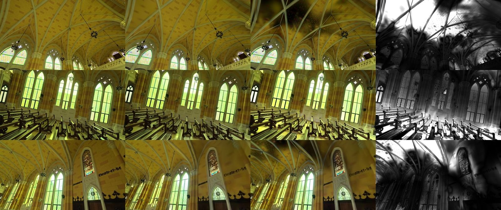
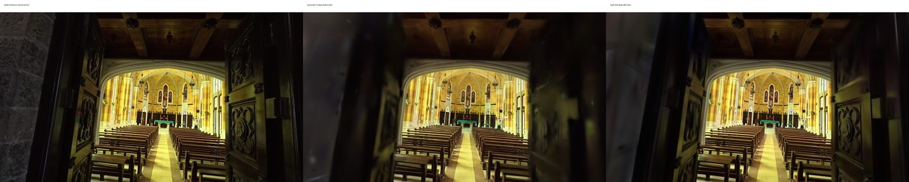

# Improvements

What changed in the pipeline, why, and how it was measured. The newest work is first. Each entry names the defect,
the evidence for it, the change, and what the change was checked against. Costs are from `modal billing report`.

## 2026-11-12: the worker redeployed, a smoke test for every deploy, a GPU to fall back on

**Evidence.** Nothing merged since PR #21 had reached a real job: the worker ran the code of 2026-11-06. There was no
way to tell whether a deploy worked short of a real capture (plan 0.6). The first job after the deploy then waited
17 minutes for an L4 that Modal did not have.

**Change.**
- `scripts/plyctl.py`: `status` (workers, queue, newest jobs) and `smoke`, which uploads a 30-second clip in parts as
  the capture app does, queues a Quick job of 2,000 steps, waits, and checks every stage's report, the gate and that
  the API serves each result file. The clip (`smoke/smoke-chapel-30s.mp4`, 15 MB, cut from a chapel clip at 1080p)
  is on both accounts' `ply-bench` Volume, not in the repository.
- `modal/ply_modal.py`: `PLY_MODAL_GPU` is a list tried in order, `L4,L40S` by default.
- The worker is deployed from this change (Modal app `ply` v18).

**Measured.** The smoke job passed on the live service in 6 minutes on an L40S: 65 of 65 views solved, 2,000 steps,
all seven stages reported, ten result files served, the top view and the evidence folder among them. The export
rule of 2026-11-11 mattered on its first real job: the filter the splat count picks would have shipped the twin at
14.6 dB with 54% of its pixels see-through, and the looser one it now falls back to gives 19.2 dB and 2.6%. The gate
fails the twin as too small, as it should at 2,000 steps. About $0.55 of L40S time by estimate, three minutes of it
an avoidable second idle wait (`MISTAKES.md`). Not covered: the hand-off to the CPU solver (under 400 frames), and
the mapper choice for a long video. Hugging Face refused the 3.6 MB model files as binary and the worker stored them
on the bucket (`STATUS.md`, known and left alone).

## 2026-11-11: a small test scene, and an export filter that was eating the twin

**Evidence.** The owner: experiments must not use up the credit before the work is done, so try them on small twins.
A chapel variant costs $0.34 to $0.43 by the runner's estimate and about a quarter more by billing. On Dr Johnson,
the first run with a weaker opacity regulariser (`q5b`) scored better than the baseline on every held-out metric and
1.65 dB worse in the viewer, with 7% of its pixels see-through: export's value filter had removed splats the picture
needed, and nothing measured it (`EXPERIMENTS.md`).

**Change.**
- `plypipe/evalrun.py`, `modal/ply_eval.py`: scenarios. The same table of variants runs on the chapel or on Dr Johnson
  (`PLY_EVAL_SCENARIO=drjohnson`: 15k steps at a 600k cap, every 8th view held out, 4 cores and 16 GiB, an L4 first).
- `stages/export.py`: the value filter is still picked by splat count, but when the twin then measures worse than
  the tolerance (0.3 dB, 1% see-through) under every cleanup, looser filters are tried against the same tolerance,
  down to `opacity>0.001`. A twin that passed before exports exactly as before.

**Measured.** Dr Johnson, same trained model, export run twice: 27.72 dB and 7.05% see-through before, 29.47 dB and
0.12% after. The small scene's noise floor is 0.02 dB; ten variants and a smoke run on it cost about $2.70 ($2.17
billed, the rest not in the report yet; `EXPERIMENTS.md`). Not measured: the chapel's exports with the new rule.

## 2026-11-11: the sparse depth loss no longer turns the model NaN

**Evidence.** Variant Q4a (`--depth-loss`) went NaN near step 158 of 15,000 on the chapel and aborted near step 570
(`EXPERIMENTS.md`). gsplat's `depth_l1_loss` at the pinned commit, run on a CPU with the trainer's own sampling
around it: a track point whose sampled depth is exactly 0 gets a NaN gradient (`where(depth > 0, 1 / depth, 0)`),
and the bilinear sample passes it to a rendered neighbour whenever the point lies exactly on a pixel row or column.
That is 1 to 5 steps in 300 with 2,000 track points on a 1728 px frame. A view with no track point in frame makes
the loss itself NaN.

**Change.** `train_launcher.py` replaces the trainer's `depth_l1_loss` when `--depth-loss` is on: the same value,
with 1 / 0 kept out of the graph, and 0 for a view without track points. It stops if more than one GPU is visible or
the pinned trainer has no such function, so a run cannot train on the old loss unnoticed.

**Measured.** On a CPU: the same loss value as gsplat's on 900 random frames, and no NaN or infinite gradient
where gsplat's sent one into a rendered pixel on 11 of them. On a GPU (Dr Johnson, `q4a`, the same night): the run
that went NaN on the chapel trains to the end, with no gain over the baseline (`EXPERIMENTS.md`).

## 2026-11-11: a top view for every twin, job limits, the eval runner (second batch)

**Evidence.** The owner: the minimap "is not like a top view of the model" (it drew the 10 cm walking grid), and Walk
"moves too slowly and catches on things" on the rebuilt chapel grid. From `PROJECT-REVIEW.md`: a job could hold a GPU
for the 6-hour container timeout and the stage limits added up to 590 minutes (U3); no run had been repeated, so no
score difference could be told from noise (T3).

**Change.**
- `plypipe/topview.py`: the exported model drawn from straight above on a CPU, each splat with its real footprint,
  composited from the top down below a cut at 1.8 m (lower under a low ceiling), transparent outside the room.
  `export` writes `topview.webp` and names it in `scene.json`; the worker uploads it; the viewer's minimap shows it,
  keeps the grid for a twin without one, and enlarges on click. `python -m plypipe.topview <folder> --write-scene`
  makes one for an existing twin.
- Viewer: Free is the default on every twin (owner's decision). The walk check is still written, no longer read.
- `plypipe/limits.py`: one GPU-time cap per job (240 min, carried across the CPU solve; a training run stopped by it
  still exports its snapshot), stage limits that are checked against their containers when the worker is deployed,
  and a 12 GB cap on a job's inputs. The frames report records each clip's colour tags and warns on HLG and PQ.
- `--holdout-block N`, `--opacity-reg`, `modal/ply_eval.py`, `scripts/eval_table.py`: the image-quality harness of
  phase 1 (`EXPERIMENTS.md`).

**Checked.** Pipeline fast suite: 244 passed, 2 skipped (they need the pinned gsplat checkout and torch), 1
deselected. The top view was rendered for the 13 twins that have a splat on Hugging Face (3 to 4.5 s and under
600 MB each), looked at one by one, and published with their `scene.json` in one commit (`ply-data` `4c46886`; the
commit before it is `4c09354`); `scene.json` differs only by the new block. In headless Chrome the built viewer opens
the chapel and the classroom in Free with the top view in the minimap. **Not measured or not run:** no job has run with
the new limits or exported a top view itself (both reach jobs at the next worker deploy); the minimap was not tried
on a phone.

**Limits.** One poor early twin (`989e2ca0`) has a top view as poor as its model. Walls are fuzzy bands, the outline
follows the scanned wall ring, and furniture above the cut is sliced. The stage limits no longer add up to less than
the container timeout, as the plan's row 0.3 asked: the job cap is what bounds a job.

## 2026-11-11: phase 0, first batch (mapper choice, evidence upload, viewer labels and injection, CI)

**Evidence.** From `PROJECT-REVIEW.md`: the global mapper was rejected on all five chapel solves and cost about 32
of the 102 solve minutes (S1); 48 evidence frames went to Hugging Face one commit each, about 18 GPU-minutes (T6);
every new twin carried a "Bad capture" badge (U4); the model page imported a module from any address and place names
were written as HTML (U5); nothing ran on a pull request (U7).

**Change.**
- `sfm.choose_mapper`: an ordered source of `--incremental-min` (400) frames or more starts with the incremental
  mapper. An explicit `--mapper` wins, and `--mapper` no longer has a default: the old default of `global` reached the
  stage as an explicit choice, so no automatic rule could have applied. The reason is in the SfM report
  (`mapperReason`). The direct route has no time cap unless `incremental_max_s` is set, because there is no second
  model to fall back on.
- `hf.upload_many` and `Api.upload_many`: the picked evidence frames and `poses.json` go up in one commit. Without
  Hugging Face, or when the commit is refused, they go to the bucket one file at a time as before.
- App: an id that is not listed gets no badge; a room module is imported only from the site's own origin; place
  names, detection classes, outliner names, the LiDAR page's error line and the library's job ids are written as text.
- `.github/workflows/ci.yml`: the API tests, the app's typecheck, build and tests, and the pipeline's fast suite on
  every pull request. `test_export_decimates_the_phone_file` now passes on a machine with no GPU, through Mesa's
  software Vulkan (`mesa-vulkan-drivers`); the test itself is unchanged.

**Checked.** Pipeline fast suite: 157 passed, 1 deselected (135 before, with the one known failure). App: typecheck
and build pass; 32 checks in `app/test` pass on Node 22 and 24. In headless Chrome a place named
`` ran script before the change and shows as text after it, and a module from another origin is
refused without being requested. **Not measured:** no job has run with the new mapper choice or the one-commit
upload. Both reach jobs at the next worker deploy, and the first long capture after it is the measurement.

**Chapel.** The rebuilt walking grid (entry below) replaced the published one on `chapel-high-2` on the owner's
decision: two files, `ply-data` commit `4c09354`. Rebuilt from the saved solve with the code on `main`, it gives the
same numbers as below, and the live walkthrough now opens in Walk.

## 2026-11-11: Walk mode on existing twins (`stages/occupancy.py`, `plypipe/walkcheck.py`)

**Evidence.** Walk was the intended mode, but the walker got stuck, so the viewer opened in Free. `walkcheck` scores
a grid with the viewer's own rules (0.22 m walker tested at 9 points, unknown cells blocked) from the spawn. On the
published `chapel-high-2` grid the reachable floor was **0.01 m²**: 2.6% of the capture positions and 6.8% of the
281 labelled places. The free cells were real (58 m²), but the walked line was one cell wide and any stray point or
pew end beside it closed it to a 0.44 m walker; the standable floor fell apart into 291 pieces.

**Change.** Rebuilt from the saved solve, with no retraining:
- The walked corridor is 0.2 m either side of the camera path and wins over blocked cells. The path is cut where the
  camera jumps (a new clip starting elsewhere), so the corridor never joins two places through a wall.
- Free space also comes from sight lines: where a line from a camera to a point it saw runs below 0.6 m, nothing
  solid stands there. A cell needs 3 lines. Blocked cells still win.
- The morphological close is gone (it bridged plain walls up to 0.6 m), free space not connected to the walk is
  dropped, and only small unknown pockets enclosed by free cells are filled.
- `occupancy.json` carries the walk check (`walk`); the viewer opens in Walk when `walk.pass` is true (at least 99%
  of capture positions reachable), and in Free otherwise.

**Measured on the chapel** (the solve of `chapel/high` on the `ply-bench` Volume; 3 s on a CPU):

| | Published grid | New grid |
|---|---|---|
| Floor reachable from the spawn | 0.01 m² | 28.1 m² |
| Capture positions reachable | 2.6% | 100% |
| Labelled places reachable (within 1.5 m) | 6.8% | 100% |
| Cells free / blocked / unknown | 5,835 / 5,505 / 6,582 | 7,465 / 4,684 / 5,773 |

834 cells that were blocked are now free, nearly all within the walked corridor along the aisles. Corridor widths
tried: 0.15 m leaves the chapel stuck (6% of positions), 0.2 m connects it, 0.3 m opens 375 more blocked cells for
no gain in reach. Letting the corridor override only cells with few points does not work: the aisles are lined with
well-observed pew ends (blocked cells in the corridor hold a median of 4 points, others 7).

**Limits.** Where the phone was held out over furniture, a 0.2 m strip of it opens (`test_walk.py` pins this). An
untextured wall thinner than about two cells (0.2 m) can still be crossed, because floor points from both sides land
in the cells it spans; the dense depth pass (plan, 2.3) is the fix. Wall crossings have not been measured against
ground truth on a real capture; that needs MuSHRoom (plan, phase 1).

**Tests.** `tests/test_walk.py` adds a two-room scene joined by a doorway through a plain 0.25 m partition: the wall
holds, the door passes, stray points beside the walk no longer trap the walker, and the old close rule is shown to
bridge that wall. The synthetic table in `synth.py` moved beside the camera loop, which used to pass over it.

## 2026-11-05: the room crop, ALIKED, the CPU camera solve

Follow-ups from the chapel test. Costs from `modal billing report`: $1.32 in total on ricco-marcelino ($1.06 of it the
ALIKED test).

| Item | Result |
|---|---|
| Room crop cost the chapel 3.4 dB | Fixed: the crop keeps what the training views draw. Chapel −0.01 dB (was −3.44), Dr Johnson 0.00 dB; the gate now keeps the crop on both |
| ALIKED features never ran | Runs now, in PyTorch (`--features aliked-lg`). Measured on the chapel: not better than SIFT, so it is opt-in |
| Camera solve on the GPU box | Split (`plypipe/handoff.py`): the GPU matches, a CPU box maps. On by default since a live chapel job passed end to end |
| Evidence frames never uploaded | Fixed: `worker.py` used `np` without importing numpy, so every capture over 48 frames failed that step silently |
| Library's Chapel card | Opens `chapel-high-2` (the current pipeline) instead of `hq-chapel-1` |

### The room crop: keep what the views need (`export.needed_crop`)

**Evidence.** Rendering the high chapel's held-out views with parts of the crop applied (`ply-crop-diag`):

| Crop | Viewer PSNR | See-through |
|---|---|---|
| none | 26.13 dB | 0.01% |
| the whole box (before) | 22.70 dB | 9.7% (worst view 39%) |
| below the floor only | 24.82 dB | 1.6% |
| above the ceiling only | 24.47 dB | 5.6% (worst view 38%) |
| the sides only | 25.55 dB | 2.5% |

Every face of the box removed something real. The box's top is the 98th percentile of the sparse points + 0.5 m, and
a smooth vault yields few sparse points, so the vault's splats sat above it (the dark patches above). The sides cut
the view through the windows, which is genuinely outside the room, and the floor cut the reflections of the polished
floor, which training places 2.6 m below it.

**Change.** A box cannot tell those from floaters, but the training photographs can. `viewer_eval.training_weights`
sums each splat's blend weight over every 5th training view, at half resolution, with the held-out views left out so
the gate still judges fairly. With colours fixed at 1 the render is the sum of the blend weights, so its gradient with
respect to each colour is that splat's weight. On the chapel's 2M splats over 237 views that took 1.3 s. The crop now
drops a splat only if it is outside the box *and* draws under 1 pixel's worth of weight (`NEEDED_PX`).
`report.export.roomCrop` records what it did. Without a GPU, the box is used as before.

**Measured.** 91% of the splats outside the chapel's box draw nothing at all (MCMC leaves many at near-zero opacity).
The threshold barely matters between 0.25 and 64 px (all the same 26.12–26.13 dB):

| Scene (high) | Outside the box | Dropped | Kept | Viewer PSNR with the crop | Without |
|---|---|---|---|---|---|
| Chapel | 167,163 | 160,688 | 6,475 | 26.11 dB | 26.13 dB |
| Dr Johnson | 60,546 | 57,184 | 3,362 | 31.02 dB | 31.02 dB |

### ALIKED + LightGlue in PyTorch (`stages/sfm_torch.py`)

**Evidence.** Neither pycolmap 4.2.1 wheel (CPU or CUDA 12) is built with ONNX Runtime; asking either for ALIKED
aborts the process (checked locally on a chapel frame).

**Change.** The same networks ship as PyTorch modules in cvg/LightGlue. `--features aliked-lg` extracts ALIKED
keypoints (4,096 per frame), pairs frames by sequence within each clip plus the 20 most similar frames by a DINOv2
descriptor (loop closure and clip-to-clip links), matches them with LightGlue, writes keypoints and matches into
COLMAP's database and lets COLMAP verify and map as usual. LightGlue (pinned), its weights and DINOv2-small are baked
into the worker image.

**Measured on the chapel** (the same 1,236 frames as the SIFT solve):

| | SIFT (default) | ALIKED + LightGlue |
|---|---|---|
| Extract + match (L40S) | 10 min | 9.6 min (71 s extract, 31,259 pairs in 7 min, 49 s verify) |
| Global mapper | rejected, 27 path jumps | rejected, 83 path jumps |
| Incremental mapper (CPU box) | 1,223 frames, 0.58 px, 58.8 min | 1,090 frames placed, then one bundle adjustment ran 52 min without finishing; stopped |

16 million matches make every bundle adjustment heavier, and the global solve is worse, not better. On this capture
it is not an improvement, so SIFT stays the default. What could change that, untested: fewer keypoints (2,048), or
LightGlue's match scores to keep only confident matches.

### The camera solve on a CPU box (`plypipe/handoff.py`)

**Evidence.** The chapel's mapping was 93 of 119 minutes, all on the CPU, with the GPU idle and billed. The same
solve on a CPU-only box took 58.8 min for $0.68 (2026-11-04, `modal/sfm_cpu.py`).

**Change.** Long captures (400 frames or more, `PLY_CPU_SFM_MIN`) are split across machines:

1. The GPU worker runs frames and matching (`--sfm-part match`), copies the job folder to the `ply-handoff` Volume,
   starts `solve` (a CPU function in the same Modal app), and goes on to the next job or stops billing.
2. `solve` maps the matches (`--only sfm --reuse-matches`) with heartbeats to the API, parks the solved folder, and
   re-queues the job (the API now resets the attempt count on a worker's re-queue, so this planned hand-back does not
   use up the job's crash retry). It starts a GPU worker unless one is running.
3. The GPU worker claims the job again, restores the solved folder, and runs the rest without downloading the clips.

If the CPU solve fails, the job fails with the solver's log. A retry solves on the GPU box instead of handing over
again, and so does a job whose solver died mid-way. Coverage checks (`--until`) and short captures are never split.

**State.** Covered by tests with stand-ins for the pipeline and the API (`tests/test_handoff.py`: hand over, solve,
resume without re-downloading; a failed solve, then a retry on the GPU). On by default since the live job below;
`PLY_CPU_SFM=0 modal deploy pipeline/modal/ply_modal.py` turns it off. Expected saving per long video: about $1.40 on an L4, $2.50 on an L40S.

**Live test (2026-11-05, chapel at Quick, 1,236 frames, L4).** Two attempts found three defects the stand-ins
could not:

1. `PLY_CPU_SFM=1 modal deploy` never turned the split on: `ply_modal.py` is imported again inside the container,
   where the deploy shell's variable is absent. The switch is now passed through the function's `env=`.
2. The hand-off ran in the pipeline subprocess, whose python cannot import Modal's injected client
   (`No module named 'modal'` right after matching). Both images now install the deploying client's `modal`.
3. The solved folder came back without `dense/` (in `handoff.SKIP`), where the solve writes the undistorted images
   and the text model, so `align` failed on the resumed GPU. `dense/` now travels back; the stand-in `align`
   checks for it.

With 1 and 2 fixed, the second attempt matched on the GPU (14 min), handed over, and the L4 stopped. The CPU box
solved 1,223/1,236 frames (global mapper rejected for 21 path jumps after 32 min, then incremental, ~90 min in all),
re-queued the job and started a GPU worker, which restored the folder and resumed after `sfm`. Then it hit defect 3.
The last leg (align onwards on the restored folder) has not run live, so the split is deployed off again.

**Live test 3 (2026-11-05/06, with all three fixes): passed.** GPU matching 15 min, then the L4 stopped. The CPU box
solved 1,222/1,236 frames in 101.7 min (global mapper rejected for 29 path jumps, then incremental). A GPU worker
resumed after `sfm` without the clips, and align, occupancy, labels, a 7k-step train and export all ran: held-out
PSNR 24.39 dB / SSIM 0.842 on 41 views, 17.9 MB SPZ, quality check ok. Billed about $3.07 for the `ply` app
for the whole job, submission to review (23:00–02:10 UTC). That includes an extra L4 start the trigger queued while the
first worker ran (it found nothing to do and idled out). Publishing took ~18 min, mostly uploading evidence frames
to Hugging Face one file at a time.

### Still open

- **The global mapper fails on the chapel** with both feature types and costs ~23 min before the fallback.
- **About 10% of the chapel's splats are blown out** at the windows: the footage's exposure.

## 2026-11-04: the chapel end-to-end test and its fixes

The chapel's 8 DJI clips (9.7 min of 4K 10-bit HEVC) went through the whole pipeline from scratch, at the quick
preset, to find what breaks or wastes time on a large real capture. The test cost $9.46: a first attempt was lost
to a client disconnect ($4.23), and the rerun cost $5.22 for 119 min on an L40S. What it showed, and what was
done about each finding:

| # | Finding (quick test, before) | Change | After |
|---|---|---|---|
| 1 | The camera solve was 103 of 119 min, on the CPU, with the GPU idle | Lighter bundle-adjustment schedule for long captures; `--reuse-matches`; `modal/sfm_cpu.py` | 58.8 min on a CPU-only box, $0.68, same solve quality |
| 2 | 3 frames posed 22–66 median steps off the walk (rows of identical pews) | `drop_spikes` removes a single view that is out and back between two neighbours | Exactly those 3 dropped; 0 path jumps left |
| 3 | Path jumps counted across clip boundaries | `trajectory_jumps` only compares frames of the same clip | Clip changes no longer send a good solve to the slow fallback |
| 4 | Floor sloped 0.86 m over the 16 m room; floor fit 16° off gravity | `geometry.gravity_guess`: gravity from the cameras' right axes, not the mean up vector | Slope 0.11 m; floor fit 2° off; floor support 5.6% → 18.7% |
| 5 | Frame extraction was 9 min of CPU video decoding on a GPU box | NVDEC (`-hwaccel cuda`) where it works, probed per codec, CPU fallback | 546 s → 129 s for all 8 clips; frames pixel-identical |
| 6 | A blurry clip keeps nearly all its frames (blur is judged within each clip) | `blurry_clips` names clips under 30% of the sharpest clip's sharpness | Reported in the frames log and report (`blurryClips`) |

The result, on the same held-out photo, which neither model trained on:

| Chapel | Quick test (7k steps, before) | High (60k steps, after) |
|---|---|---|
| Held-out PSNR / SSIM / LPIPS (41 views) | 23.37 / 0.820 / 0.323 | 25.59 / 0.872 / 0.212 |
| As the viewer shows it (12 views) | 24.00 dB, 0.66% see-through | 26.11 dB, 0.01% see-through |
| Desktop file (`scene.spz`) | 23.97 dB, 17.7 MB | 26.07 dB, 39.0 MB |
| Phone file (`scene_lite.spz`) | 23.97 dB, 17.7 MB | 23.92 dB, 21.9 MB (800k splats) |
| Splats shipped | 752,661 | 1,058,149 |
| GPU time and cost | 119 min, $5.22 (camera solve included) | 33.5 min, $1.49 (frames and camera solve reused) |

Most of the score gain is the high preset (60k steps, 2M splats against 7k and 1M), not the fixes. The fixes show
in the solve and the floor (rows 2–4), which a score on 12 held-out views barely registers. Published as
`scenes/chapel-high-2` (labelled "Latest pipeline" in the viewer); the library card still points at the older
`hq-chapel-1`.

### 1. The camera solve: from the GPU box to a CPU box

**Evidence.** The first attempt's global mapper ran 23 min and was rejected (57 path jumps), so the rerun went
straight to the incremental mapper: extraction and matching took 10 min (GPU), then incremental mapping took 93 min
(07:02 to 08:35, undistortion included). COLMAP's bundle adjustment runs on the
CPU: the pycolmap-cuda12 wheel's Ceres has no CUDA ("Ceres was compiled without CUDA support"). The GPU box bills
about $2.58/h on an L40S (GPU, 8 cores, 32 GB) and $1.43/h on an L4. A CPU-only box with the same cores and memory
bills $0.63/h.

**Change.**
- `sfm.incremental_options`: above 400 frames, global bundle adjustment runs after 25% growth, not 10%
  (`ba_global_frames_ratio` and `ba_global_points_ratio` 1.25), and skips redundant 3D points
  (`ba_global_ignore_redundant_points3D`).
- `--reuse-matches`: re-solves from `colmap/database.db` without extracting or matching again. Matching writes
  `colmap/matching.json` so a reused solve still reports which features and matcher it used.
- `pipeline/modal/sfm_cpu.py`: runs that re-solve on a CPU-only Modal container and saves the solved job for
  `plypipe run --from align`.

**Measured** (chapel, the same 1,236 frames and matches): 58.8 min on the CPU box for $0.68. It registered 1,223
frames with 0 path jumps, 431k points and 0.582 px error, against 1,226 frames, 433k points and 0.581 px on the GPU
box before the spike filter. The GPU box's incremental mapping took 93 min on the same 8 cores and memory, so the
lighter schedule is the likely cause of the difference, though the two containers' CPUs may differ.

**Not done yet.** The live worker still runs a whole job in one GPU container. Moving the solve there to a CPU
container means splitting a job across containers (GPU: frames, features, matching; CPU: mapping, align, occupancy;
GPU: labels, training, export) with the job folder handed over between them, which touches the worker and the API
and needs a real test job. Saving per long video: about $1.40 (L4) to $2.50 (L40S) at the chapel's size.

### 2. Mismatched poses dropped (`sfm.drop_spikes`)

**Evidence.** Frames 310, 760 and 770 sat 66, 24 and 25 median steps from both neighbours, and those neighbours
sat one step apart. Frame 310 looks down rows of identical pews, so its pose was most likely matched to the wrong
pew. Training would bake each one in as a ghost.

**Change.** After the solve, a view is deregistered when both of its steps exceed 8 median steps and its two
neighbours sit within a quarter of the shorter step. A path that breaks and carries on elsewhere (a folded model)
is left alone and still reported as a jump. Dropped views are listed in `report.sfm.droppedSpikes`.

**Checked** on the chapel's real solve: exactly those 3 frames are dropped, and jumps go from 6 to 0. Tests
cover a spike, a real break, and clip boundaries.

### 3. Path jumps counted within a clip (`sfm.trajectory_jumps`)

**Evidence.** The jump counter compared consecutive frame numbers, and the next clip's first frame follows the
previous clip's last one, wherever in the room that clip starts. Any jump sends a global solve to the slow
incremental fallback.

**Change.** Steps are only measured between frames of the same clip (`frames_index.json`). Photo sets and older
jobs without the index behave as before.

### 4. Gravity from level cameras (`geometry.gravity_guess`)

**Evidence.** Alignment took "up" as the mean of the cameras' up vectors. On the chapel most upward shots faced the
altar, so the mean tilted 4.8° toward it. RANSAC found no floor (2.5% support, 16° off), the gravity fallback
inherited the tilt, and the floor ran 0.86 m downhill along the 16 m room. The room crop was then refused,
because cropping a tilted room would have hidden 24% of every view.

**Change.** A walk keeps the camera level but pitches it freely, so the cameras' right axes stay horizontal. The
least-spread direction of their scatter is gravity. When the camera never turned, or the answer is more than 25°
from the mean up vector (a sideways video), the mean up vector is used as before. `report.align.gravityFrom` says
which was used.

**Checked.** On the chapel's solve the floor slope fell from 0.86 m to 0.11 m end to end. In the high run the floor
fit landed 2° off gravity, and 18.7% of points lie on the floor (5.6% before). Tests cover pitch-biased cameras and
the fallback.

### 5. GPU video decoding (`frames.decode_args`)

**Evidence.** The frames stage decodes every source frame on the CPU to keep the sharpest per window: 546 s for the
chapel's 9.7 min of 4K HEVC.

**Change.** Where `nvidia-smi` exists, one frame is test-decoded with `-hwaccel cuda` per codec. If that works, the
clip is decoded on NVDEC; if decoding fails part-way, the clip is redone on the CPU. `PLY_NO_HWDEC=1` turns it off.
`report.frames.clips[].decoder` records which was used.

**Measured.** A 30 s clip: 25.7 s on the CPU, 4.8 s on NVDEC, with frames identical to the CPU path at
138 dB PSNR (no difference). All 8 clips: 546 s → 129 s.

### 6. Blurry clips reported (`frames.blurry_clips`)

**Evidence.** Frames are dropped only against their own clip's median sharpness, so a clip that is soft throughout
keeps nearly every frame: the chapel's 0053 sat at 27% of the sharpest clip and lost 3 of 240.

**Change.** Clips under 30% of the sharpest clip's median are named in a warning and in `report.frames.blurryClips`.
They are not cut: frames that are the only view of a place still beat a gap in the solve. The threshold is 30%, not
40%, because darkness lowers the measure too (the chapel's dim but sharp 0064 sat at 37%).

### Still open (as of 2026-11-04)

- The room crop and ALIKED: both addressed on 2026-11-05, above.
- **The global mapper fails on the chapel**, even with clip-aware jump counting (27 genuine jumps), and costs
  ~23 min before the fallback.
- **About 10% of the chapel's splats are blown out** at the windows. That is the footage's exposure, not the pipeline.

### Tests and tools

- 117 fast tests pass (`pytest -m "not slow"`). `test_export_decimates_the_phone_file` needs a WebGPU adapter and
  fails without one, as on `main`.
- `pipeline/modal/chapel_e2e.py`: fetches the chapel clips from Drive onto the `ply-bench` Volume and runs the
  pipeline resumably, saving each finished stage. `pipeline/modal/sfm_cpu.py`: the CPU re-solve.

## 2026-11-03: export precision (PR #7)

**Evidence.** On Dr Johnson high, the trained model scored 31.0 dB on held-out photos, the desktop viewer showed
29.8 dB and phones 26.4 dB. splat-transform rounds spherical harmonics to 4–5 bits when it writes SPZ (the format
holds 8). Spark's default in-memory packing stores positions at half precision, and the phone file dropped SH
entirely.

**Change.** `plypipe/spz.py` rewrites the SH block at 6 bits from the cleaned PLY, after checking both files hold the
same splats. The phone file keeps SH up to degree 2, and the export scores the shipped files (`shippedEval`).
Desktop loads with Spark's `extSplats` (float32 positions).

**Measured** (Dr Johnson high, simulated through Spark's encoders): desktop 29.8 → 30.9 dB, phone 26.4 → 29.0 dB.
Files grew from 22 to 29 MB (desktop) and 13 to 19 MB (phone). Training with 2M splats instead of 1.47M gave
31.06 against 31.02 dB, so more training was not the headroom.

## 2026-11-02: export cleanup and brightness (PR #4)

**Evidence.** The Dr Johnson twins had see-through gaps (the room-box crop removed walls and doorways; the
floater filter removed large distant splats) and opened up to 25% too bright (PPISP's exposure correction is
trained in but never applied by the viewer).

**Change.** Each cleanup step is scored the way the viewer shows the twin (`viewer_eval.py`) and dropped if it
costs more than 0.3 dB or opens 1% more see-through pixels. PPISP is off by default. Twins are capped at 2M splats
after two 3M-splat runs went unstable.

**Measured.** Low 20.2 → 29.0 dB, medium 20.4 → 30.8 dB, high 18.6 → 31.0 dB, with brightness ×1.00 and no gaps.
